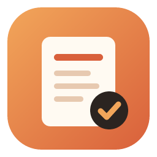
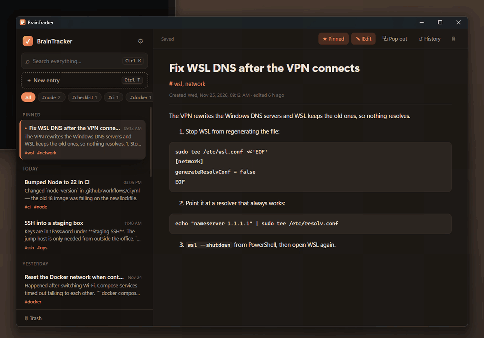
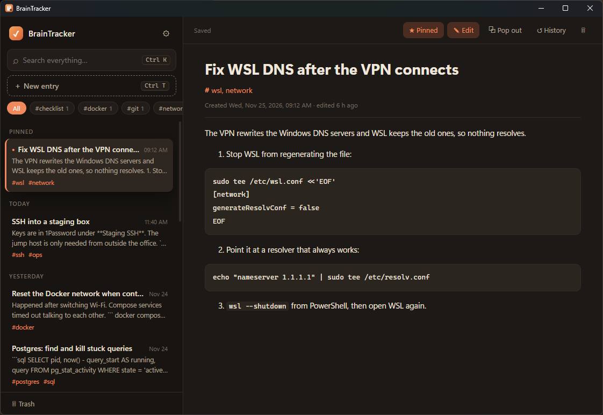
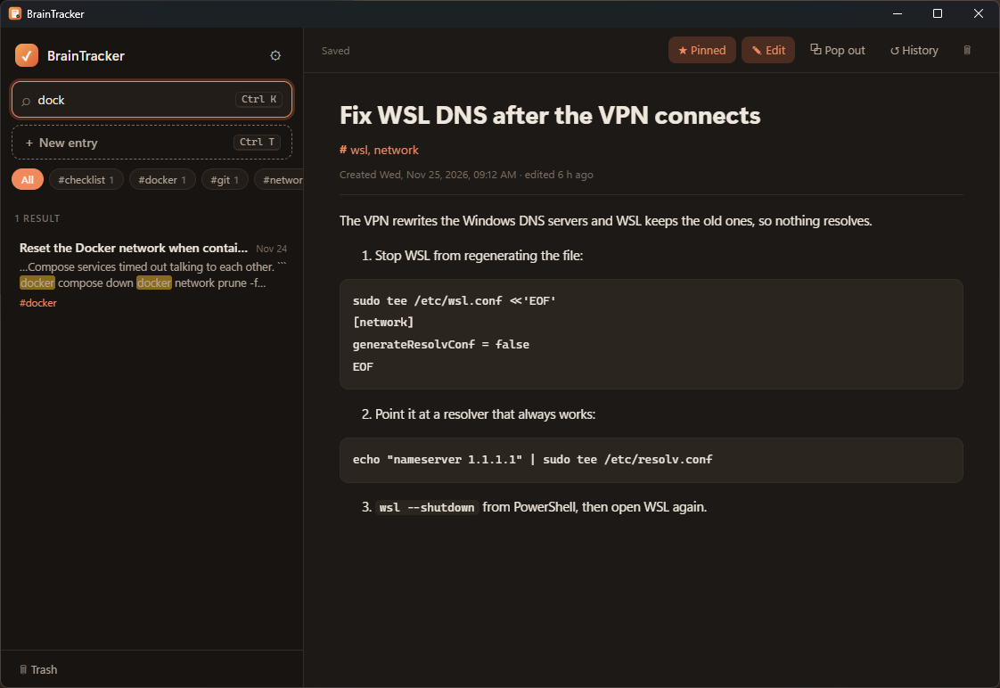
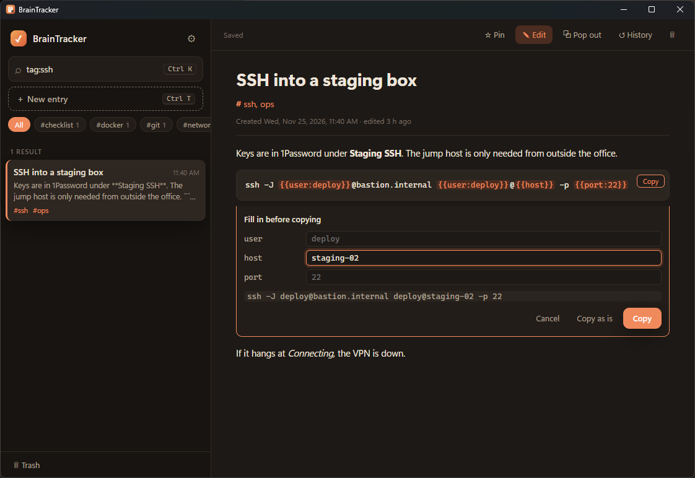
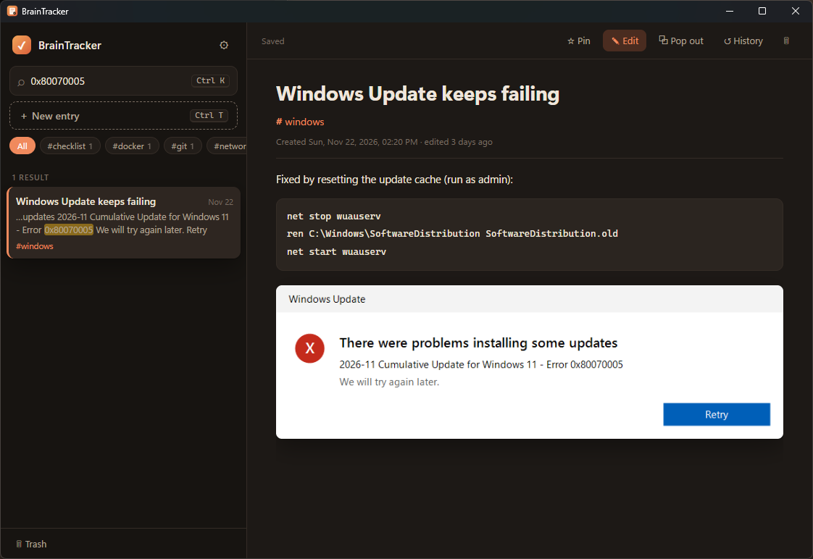
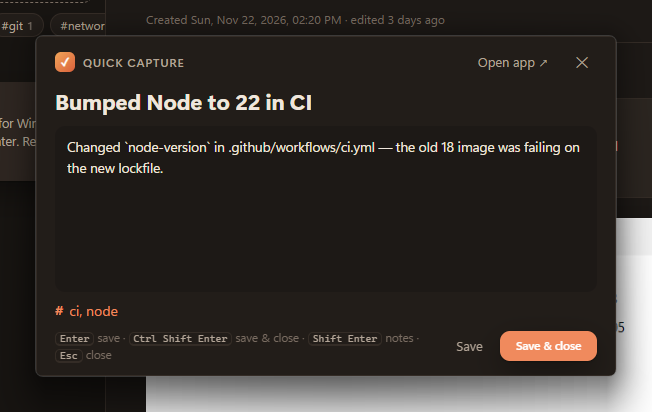
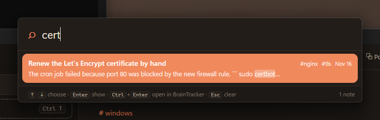

<div align="center">



# BrainTracker

**For the things you'll forget — and need again someday.**

A tiny, fast, offline-first Windows app for jotting down what you just did: the fix, the command,<br/>
the setting you changed, the screenshot that explains it. Write it in seconds, find it again in seconds.<br/>
Plus an **Android app** that keeps the same notes, synced straight from your PC — no cloud, no account.

[](https://github.com/ioannismil/braintracker/releases/latest)
[](https://github.com/ioannismil/braintracker/actions/workflows/release.yml)
[](https://github.com/ioannismil/braintracker/releases)

[](https://tauri.app)
[](LICENSE)

[**Download**](#-download) · [Features](#-features) · [Screenshots](#-screenshots) · [Phone app](#-phone-app--sync) · [Shortcuts](#%EF%B8%8F-keyboard-shortcuts) · [Command line](#-command-line) · [Your data](#-your-data) · [Build from source](#%EF%B8%8F-build-from-source)

<br/>



<sub>Search as you type · fill in a command's blanks, then copy · find a screenshot by the text in it · capture and search from anywhere · <a href="docs/media/demo.mp4">watch in full quality (MP4)</a></sub>

</div>

---

## 🧠 What it is, and what it isn't

You fix something tricky, and six months later it breaks again. You remember fixing it, but not *how*. BrainTracker is for that moment: a place to drop the details you'd otherwise forget, so you never have to work them out twice.

It's deliberately **not** a knowledge base or a "second brain". Apps like Obsidian or Notion are great for building connected notes you organise and come back to on purpose. BrainTracker asks for none of that: no folders, no links between notes, no structure to keep up. You write a few lines while it's fresh, add a tag if you feel like it, and move on. When you need it later, you search and it's there.

Think of it as a memory you can search, not a library you keep tidy.

## ✨ Features

<table>
<tr>
<td width="50%" valign="top">

### ⚡ Capture in seconds
Press <kbd>Ctrl</kbd> <kbd>Shift</kbd> <kbd>E</kbd> anywhere — a small popup appears on top of whatever you're doing. Type what you did, hit <kbd>Enter</kbd>, done. Click away and your half-written note is kept. Select some text in any app and press <kbd>Ctrl</kbd> <kbd>Shift</kbd> <kbd>D</kbd> instead to drop it straight into the notes of a new entry.

</td>
<td width="50%" valign="top">

### 🔎 Find anything instantly
Full-text search across titles, notes and tags, as you type, with highlighted matches. Partial words match, so `dock` finds *Docker*. Narrow it down with filters like `tag:docker`, `has:image` or `after:2026-10`. Or press <kbd>Ctrl</kbd> <kbd>Alt</kbd> <kbd>Space</kbd> anywhere for a Spotlight-style search bar that shows your notes as you type. Staring at an error? Select it and press <kbd>Ctrl</kbd> <kbd>Alt</kbd> <kbd>Shift</kbd> <kbd>Space</kbd> to search for it; if no note has every word, you get the closest matches.

</td>
</tr>
<tr>
<td valign="top">

### 📝 Notes that hold the "how"
Markdown with code blocks (each with a one-click **Copy** button), lists and links. Write blanks into a command, like `ssh {{user}}@{{host}} -p {{port:22}}`, and **Copy** asks for the values first, remembering them for next time (see **Settings → Commands**). Paste screenshots straight in with <kbd>Ctrl</kbd> <kbd>V</kbd>, and the text in them becomes searchable too (read offline by Windows' built-in OCR), so searching an error code finds the screenshot of that error. Everything auto-saves as you type.

</td>
<td valign="top">

### 🗂️ Easy to navigate
Entries grouped by *Today · Yesterday · This week · month*. Pin the important ones to the top. Browse with the arrow keys without touching the mouse. **Pop out** a note into a small window that stays on top of other apps, to follow its steps while you work.

</td>
</tr>
<tr>
<td valign="top">

### 🖥️ Always there, never in the way
Starts with Windows and lives in the system tray. Summon the full window with <kbd>Ctrl</kbd> <kbd>Shift</kbd> <kbd>Space</kbd>. Closing just hides it.

</td>
<td valign="top">

### 🔒 Yours, and offline
No account, no cloud, no telemetry. One local SQLite file you can export to plain Markdown anytime. Every shortcut is configurable. Turn on **offline mode** and BrainTracker makes no network connections at all: no update checks, no web images.

</td>
</tr>
<tr>
<td valign="top">

### 🛟 Automatic backups
A daily snapshot whenever something changed — to `Documents`, OneDrive or any folder you pick. Keeps the newest 30; restore any of them in one click.

</td>
<td valign="top">

### 🔄 Updates itself
Checks GitHub for new releases and installs them with one click — your data and settings carry over. Portable copies get a download link instead.

</td>
</tr>
<tr>
<td valign="top">

### ↺ Nothing is lost by accident
Deleting moves an entry to the **Trash** for 30 days (with an instant *Undo*). Every entry keeps an **edit history** — step back to any earlier version.

</td>
<td valign="top">

### 📦 Bring your notes with you
**Import** folders of Markdown or text notes — titles, tags, dates and images included. Round-trips cleanly with BrainTracker's own Markdown export. Or switch on the **inbox folder**: anything you save into it (say, a OneDrive folder, from your phone) becomes an entry automatically.

</td>
</tr>
<tr>
<td valign="top">

### 📱 On your phone too
The **Android app** has all your notes in your pocket: search, tags, pinned notes, code blocks with **Copy**, screenshots, the trash — and you can write and edit notes there too, including adding photos.

</td>
<td valign="top">

### 🔁 Syncs without a cloud
Pair the phone once by scanning a QR code on the PC. From then on they sync **directly** — over your Wi-Fi at home, or from anywhere with [Tailscale](https://tailscale.com) — encrypted end to end. Edited on both? The later edit wins and the other is kept in History.

</td>
</tr>
</table>

## 📸 Screenshots

<table>
<tr>
<td width="50%" valign="top">

<p align="center"><sub><b>Your notes</b> — grouped by day, pinned ones on top, code ready to copy</sub></p>
</td>
<td width="50%" valign="top">

<p align="center"><sub><b>Search as you type</b> — partial words match, results highlighted</sub></p>
</td>
</tr>
<tr>
<td valign="top">

<p align="center"><sub><b>Commands with blanks</b> — <b>Copy</b> asks for the values, remembers them</sub></p>
</td>
<td valign="top">

<p align="center"><sub><b>Text in screenshots is searchable</b> — an error code finds its screenshot</sub></p>
</td>
</tr>
<tr>
<td valign="top">

<p align="center"><sub><b>Quick capture</b> — <kbd>Ctrl</kbd> <kbd>Shift</kbd> <kbd>E</kbd> from any app</sub></p>
</td>
<td valign="top">

<p align="center"><sub><b>Quick search</b> — <kbd>Ctrl</kbd> <kbd>Alt</kbd> <kbd>Space</kbd> from any app</sub></p>
</td>
</tr>
</table>

## 📥 Download

Grab the latest version from the **[Releases page](https://github.com/ioannismil/braintracker/releases/latest)**:

| | File | Best for |
|---|---|---|
| 🧩 **Installer** | `BrainTracker_x.y.z_x64-setup.exe` | Everyday use — Start menu entry, launches at startup, no admin rights needed |
| 🎒 **Portable** | `BrainTracker_x.y.z_x64_portable.zip` | No install — unzip anywhere (even a USB stick); data stays inside the folder |
| 📱 **Android** | `BrainTracker_x.y.z_android.apk` | Your notes on your phone, synced with the PC — open the file on the phone to install it |

> [!NOTE]
> BrainTracker isn't code-signed yet, so Windows SmartScreen may say *"Windows protected your PC"*. Click **More info → Run anyway**.
> It uses the Microsoft Edge WebView2 runtime, which is already installed on Windows 11 and up-to-date Windows 10.

**Updating:** automatic — BrainTracker shows *"Update available"* in the sidebar; click **Install & restart**. (You can also check from **Settings → Updates**.) Portable users download the new zip and copy their `data` folder over.

**Android:** the app isn't on Google Play — download the `.apk` on your phone and open it. Android asks once whether your browser may install apps; allow it. To update, install the newer `.apk` the same way. (Until releases are signed with a permanent key, Android may refuse to install a new version over the old one: uninstall the old app first — your notes come back from the PC on the next sync.)

## 📱 Phone app & sync

The Android app keeps a full copy of your notes and syncs with BrainTracker on your PC. There's no BrainTracker server or account: the phone talks **directly** to your PC.

**Pair once:**
1. On the PC: **Settings → Sync with your phone → Pair a phone**. A QR code appears (valid for 10 minutes, for one phone).
2. On the phone: tap the sync badge at the top (or **Get your notes from your PC**) → **Scan the QR code**. Can't scan? Choose **Paste the code as text instead** — the PC can show the code as text too.
3. The first time, Windows may ask whether BrainTracker can use your network: allow **private networks**, or the phone can't reach the PC. On Android 17 and later, allow **Nearby devices** when the app asks — that's what lets it reach your PC on your Wi-Fi.

**Then it just syncs:** when the app opens, a couple of seconds after you edit something, and every minute or so while it's open — whenever the phone can reach the PC. Notes, tags, pins, the trash, deletions, screenshots and the text read from them all sync; edit history, settings and backups stay on each device. If a note was changed on both since they last synced, the later change wins, and the other version is kept in that note's **History**, so nothing is lost.

**Where it works:**
- **At home:** the phone and the PC on the same Wi-Fi.
- **Anywhere:** with [Tailscale](https://tailscale.com) on both (free for personal use), the phone reaches your PC from any network. Nothing extra to set up in BrainTracker — the pairing code already includes the PC's Tailscale address.

**Private by design:** each phone gets its own random 256-bit key from the QR code, and every request and reply is encrypted with it (XChaCha20-Poly1305), so nobody else on the network can read or change your notes. Remove a phone in **Settings → Sync with your phone** and its key stops working. Turning on **offline mode** on either device pauses sync.

<details>
<summary><b>Phone can't reach the PC?</b></summary>

- Check that BrainTracker is running on the PC with **Sync with your phone** switched on (it can stay in the tray).
- Open `http://<your PC's address>:47812/` in the phone's browser (the address is shown under **Sync with your phone**). If it says *"BrainTracker on this PC can be reached"*, the network is fine: check that the app has the **Nearby devices** permission (**Settings → Apps → BrainTracker → Permissions**).
- If the page doesn't load, the phone isn't on the same network (mobile data, a guest Wi-Fi), the router keeps Wi-Fi devices apart ("AP/client isolation"), or the PC's firewall is blocking BrainTracker (**Windows Security → Firewall → Allow an app**). Tailscale on both gets around all of these.

</details>

## ⌨️ Keyboard shortcuts

| Action | Default | Where |
|---|---|---|
| Show / hide BrainTracker | <kbd>Ctrl</kbd> <kbd>Shift</kbd> <kbd>Space</kbd> | 🌐 anywhere |
| Quick capture | <kbd>Ctrl</kbd> <kbd>Shift</kbd> <kbd>E</kbd> | 🌐 anywhere |
| Quick capture with the selected text | <kbd>Ctrl</kbd> <kbd>Shift</kbd> <kbd>D</kbd> | 🌐 anywhere |
| Quick search | <kbd>Ctrl</kbd> <kbd>Alt</kbd> <kbd>Space</kbd> | 🌐 anywhere |
| Quick search for the selected text | <kbd>Ctrl</kbd> <kbd>Alt</kbd> <kbd>Shift</kbd> <kbd>Space</kbd> | 🌐 anywhere |
| New entry | <kbd>Ctrl</kbd> <kbd>T</kbd> | in the app |
| Search | <kbd>Ctrl</kbd> <kbd>K</kbd> | in the app |
| Toggle Markdown preview | <kbd>Ctrl</kbd> <kbd>E</kbd> | in the app |
| Settings | <kbd>Ctrl</kbd> <kbd>,</kbd> | in the app |

All of these can be changed in **Settings → Keyboard shortcuts** — click one, press the new keys. Your choices are kept when BrainTracker updates; a shortcut added in a new version never takes keys you already use. Shortcuts follow the physical key, so they work on any keyboard layout.

### 🔎 Search filters

Type these in the search box, on their own or together with words:

| Filter | Finds entries… |
|---|---|
| `tag:docker` | tagged *docker* (repeat for several tags) |
| `after:2026-10` · `before:2026` | created on/after or before a year, month or day |
| `on:2026-11-17` · `on:2026-11` | created on that day / in that month or year |
| `has:image` · `has:code` · `has:link` | with a screenshot, code, or a web link |
| `is:pinned` | that are pinned |

Example: `vpn tag:home after:2026-01 has:code`

<details>
<summary><b>More keys</b></summary>

| Where | Keys |
|---|---|
| Search box | <kbd>↑</kbd> <kbd>↓</kbd> browse results · <kbd>Enter</kbd> open · <kbd>Enter</kbd> with no results creates an entry with that title · <kbd>Esc</kbd> clear |
| Quick capture | <kbd>Enter</kbd> save (stays open for the next one) · <kbd>Ctrl</kbd>+<kbd>Shift</kbd>+<kbd>Enter</kbd> save & close · <kbd>Shift</kbd>+<kbd>Enter</kbd> jump to notes · <kbd>Ctrl</kbd>+<kbd>O</kbd> open app · <kbd>Esc</kbd> close — all changeable in Settings |
| Quick search | type to find notes · <kbd>↑</kbd> <kbd>↓</kbd> choose · <kbd>Enter</kbd> show the whole note · <kbd>Enter</kbd> again or <kbd>Ctrl</kbd>+<kbd>Enter</kbd> open it in BrainTracker · <kbd>Ctrl</kbd>+<kbd>P</kbd> pop it out on top · <kbd>Esc</kbd> back / clear / close |
| Popped-out note | <kbd>Esc</kbd> close · **📌 On top** toggles staying above other apps · **✎ Edit** opens it in BrainTracker |
| Editor | <kbd>Tab</kbd> indents · <kbd>Ctrl</kbd>+<kbd>V</kbd> pastes screenshots · double-click the preview to edit |

</details>

## 💻 Command line

Everything works from the terminal too — straight on your notes, without opening a window — so you can script it. On Windows use **`bt`**, installed next to BrainTracker (on Linux/macOS, `braintracker` works the same).

```powershell
bt search docker dns                 # find notes (filters work: tag:wsl has:code after:2026-10)
bt list --tag docker                 # recent notes
bt show 12                           # print a note in full
bt add "Fixed DNS in WSL" --tags wsl,network --body "Set nameserver 1.1.1.1"
git log -1 | bt add "Today's release" --body -      # - reads the text from stdin
bt edit 12 --append "Also needed a restart"
bt pin 12 · bt unpin 12 · bt delete 12 · bt tags
bt list --json                       # machine-readable output for scripts
```

Add **`--open`** to do it in the app instead:

| Command | Opens |
|---|---|
| `bt --open` | BrainTracker |
| `bt search [words] --open` | Quick search (with those words typed in) |
| `bt search --open --selection` | Quick search for the text selected in the app in front |
| `bt add --open` | Quick capture |
| `bt add --open --selection` | Quick capture with the text selected in the app in front |
| `bt show 12 --open` | Note #12 in BrainTracker |

That makes them easy to bind to a desktop shortcut, a launcher, or your desktop's own keyboard settings. `bt --help` lists everything.

To type just `bt` in any terminal, add BrainTracker's folder to your PATH once (PowerShell):

```powershell
[Environment]::SetEnvironmentVariable("Path", [Environment]::GetEnvironmentVariable("Path", "User") + ";$env:LOCALAPPDATA\BrainTracker", "User")
```

## 💾 Your data

Everything stays on your machine.

| | Location |
|---|---|
| Installed | `%APPDATA%\com.braintracker.app\` |
| Portable | `data\` next to `BrainTracker.exe` |
| Android | the app's private storage (removed when you uninstall it) |

Inside you'll find `braintracker.db` (all entries, plus the text read from your screenshots) and `images\` (pasted screenshots).

**Text in screenshots** is read in the background by Windows' own OCR. Nothing is uploaded. Screenshots from before this feature are read the first time the app starts. It uses the OCR languages installed in Windows (**Settings → Time & language → Language & region**); with none, screenshots simply aren't searchable.

**Backups** run automatically once a day when something changed, into `Documents\BrainTracker Backups` (portable: `data\backups`). Change the folder, how many to keep, or restore one in **Settings → Automatic backups**. A restore always saves a *before-restore* snapshot of your current data first, and keeps your current settings.

**Trash & history:** deleted entries wait in the **Trash** (sidebar, bottom) for 30 days. While you edit, a version is saved at most every 10 minutes (last 50 per entry) — open **↺ History** in the editor to compare and restore.

**Export & import:** **Settings → Export** writes every entry as a Markdown file — screenshots included — to `Documents\BrainTracker Export`. **Settings → Import** reads Markdown/text files or whole folders back in (titles, tags, dates, front matter and local images), skipping anything already imported.

**Inbox folder:** **Settings → Inbox folder** watches a folder (by default `Documents\BrainTracker Inbox`) and imports Markdown/text files and images put into it, tagged `#inbox`, then moves them into its `Imported` subfolder. A file is only imported once it has stopped changing, so files still being synced are left alone. Pick a folder inside OneDrive, Dropbox or Google Drive to capture from your phone through that service's app.

**Offline mode:** **Settings → Offline mode** stops every network connection BrainTracker makes: update checks, phone sync and web images in notes (shown as a placeholder instead). Links still open in your browser when you click them.

**Phone sync:** the PC only listens for the phone while **Settings → Sync with your phone** is on, on port `47812` (TCP), plus `47813` (UDP) so a paired phone can find the PC again if its address changes. Text in screenshots is read on the PC and sent to the phone, so search finds it there too.

**Clean up:** **Settings → Clean up screenshots** removes pasted images no entry, trashed entry or old version still uses.

> [!TIP]
> Any copy of `BrainTracker.exe` becomes portable when a file named `portable.txt` sits next to it.

## 🛠️ Build from source

**Requirements:** [Node.js 20+](https://nodejs.org), [Rust (stable)](https://rustup.rs), Windows 10/11.

```powershell
git clone https://github.com/ioannismil/braintracker.git
cd braintracker
npm install

npm run app:dev       # run with hot reload
npm run app:build     # build the installer → src-tauri/target/release/bundle/nsis/
cargo test --manifest-path src-tauri/Cargo.toml   # run the tests
```

**Android app:** also needs [Android Studio](https://developer.android.com/studio) (SDK + NDK), JDK 17 and the Rust Android targets (`rustup target add aarch64-linux-android armv7-linux-androideabi x86_64-linux-android`). The Android project lives in `src-tauri/gen/android`.

```powershell
npx tauri android dev                              # run on a connected phone or emulator
npx tauri android build --apk --target aarch64     # build an APK for phones
```

On Windows, `tauri android build` links the app's library into the Android project with a symbolic link, which needs **Developer Mode** on (**Settings → System → For developers**). The release workflow builds the APK on Linux, so it doesn't need it.

**End-to-end tests** drive the real, built app the way a person would: every window, button and keyboard shortcut, plus `bt` while the app is open. They run against a portable copy with its own empty data, so your notes are never touched.

```powershell
cargo install tauri-driver --locked   # once
npx tauri build --no-bundle           # build the app to test
npm run e2e                           # everything; presses real keys, so don't type while it runs
npm run e2e -- --stop-app             # same, quitting your running BrainTracker first (restarted after)
npm run e2e -- --ci                   # skip tests that need a real desktop
npm run e2e -- --demo --stop-app      # re-record the README screenshots + video (needs ffmpeg)
```

The README media in `docs/media/` comes from `--demo` (`e2e/demo.mjs`): it fills a throwaway copy of the app with example notes and records it in front of a plain backdrop, so your own notes and desktop never appear. Screenshots of any failures go to `e2e/out/`. They aren't run by the release workflow (desktop tests don't suit GitHub's Windows machines), so run them before pushing app changes.

<details>
<summary><b>Project structure</b></summary>

```
braintracker/
├─ src/                      React + TypeScript UI
│  ├─ App.tsx                main window: sidebar, list, editor
│  ├─ Capture.tsx            quick-capture popup
│  ├─ Settings.tsx           settings dialog & shortcut recorder
│  ├─ Backups.tsx · DataTools.tsx   backups, import, image cleanup
│  ├─ Trash.tsx · History.tsx       trash and edit-history dialogs
│  ├─ PhoneSync.tsx          Settings → Sync with your phone (pairing QR code)
│  ├─ mobile/                the phone app's touch layout
│  ├─ markdown.ts            Markdown rendering + code copy buttons
│  ├─ shortcuts.ts           layout-independent shortcut matching
│  └─ images.ts              screenshot paste / rendering
├─ src-tauri/                Rust backend (Tauri 2)
│  ├─ src/db.rs              SQLite schema, FTS5 search & filters, trash, history
│  ├─ src/backup.rs          daily backups & restore
│  ├─ src/import.rs          Markdown/text import
│  ├─ src/updates.rs         auto-update from GitHub Releases
│  ├─ src/sync/              phone sync: PC server, phone client, encryption, tests
│  ├─ src/lib.rs             note commands shared by both apps, the phone app's entry point
│  ├─ src/desktop.rs         the desktop app: tray, global shortcuts, popups, autostart
│  ├─ gen/android/           the Android project
│  └─ tauri.conf.json        windows, bundle & version (major.minor)
├─ e2e/                      end-to-end tests that drive the real app (npm run e2e)
├─ scripts/set-version.mjs   stamps the release version into all manifests
└─ .github/                  CI, release pipeline, Dependabot
```

</details>

**Tech stack:** [Tauri 2](https://tauri.app) · Rust · [SQLite](https://sqlite.org) with FTS5 via [rusqlite](https://github.com/rusqlite/rusqlite) · React 19 · TypeScript · Vite · [marked](https://marked.js.org) + [DOMPurify](https://github.com/cure53/DOMPurify)

## 🚀 Releases are automatic

Every push to `main` runs the [Release workflow](.github/workflows/release.yml), which:

1. runs the test suite,
2. builds the app and the NSIS installer,
3. packages the portable zip,
4. signs the installer and publishes `latest.json`, which installed copies use to update themselves,
5. publishes a GitHub release tagged **`v<major>.<minor>.<build>`** with a changelog generated from the commits since the previous release,
6. builds the Android app on Linux and adds the signed `.apk` to the same release.

- To start a new version series, change `major.minor` in [`src-tauri/tauri.conf.json`](src-tauri/tauri.conf.json) (e.g. `0.2.0` → releases become `v0.2.N`).
- Commits that only touch Markdown/docs don't trigger a release. Add `[skip ci]` to a commit message to skip one manually.
- Pull requests are checked by the [CI workflow](.github/workflows/ci.yml); [Dependabot](.github/dependabot.yml) keeps dependencies up to date.
- Update signing uses the `TAURI_SIGNING_PRIVATE_KEY` repository secret. Without it, releases still publish — just without auto-update files.
- The APK is signed with the keystore in the `ANDROID_KEYSTORE` (base64) and `ANDROID_KEYSTORE_PASSWORD` secrets. Without them it's signed with a one-off key, so a new version won't install over the previous one.

## 📄 License

[MIT](LICENSE) — free to use, modify and share.

---

<div align="center">
<sub>Made for people who solve the same problem twice and wish they'd written it down the first time.</sub>
</div>
